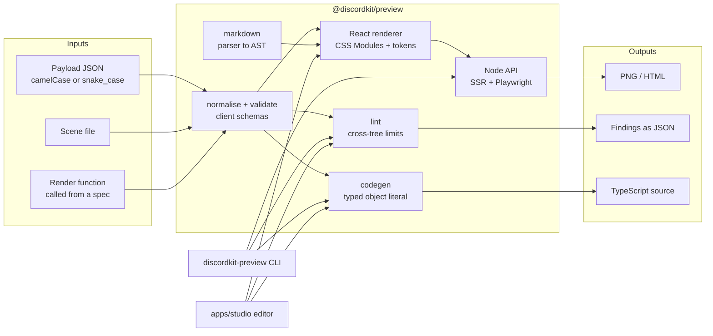

# Spec — `@discordkit/preview`, a Discord message renderer that agents can drive

> Status: **Draft, awaiting review** · Owner: Drake Costa · Spec dated 2026-11-24
>
> Scope of v0: **render a message payload to a PNG that matches the Discord web client**, from a Node API and a CLI, for the component set Inbou and Tome actually use. The interactive editor comes after the renderer is proven.
>
> Package and binary names in this document are proposals. Nothing has been published.
>
> Progress is tracked in the slice table in §13. Sections marked "as built" (§4a, §6a) record what an implemented slice established, and take precedence over the proposal text around them.

## 1. Goal

Close the review loop on Discord message design. Today an agent can build a message payload and validate it, but it cannot see it. Every layout decision in Inbou and Tome was made by posting to a dev channel and waiting for a human to send screenshots back.

The tool has three audiences, in priority order:

1. **Agents and test suites.** Payload in, PNG out, with lint findings alongside. No bot token, no channel, no command re-registration.
2. **Developers at a terminal.** The same thing as a CLI, plus generated code for a payload.
3. **Humans designing a message.** An interactive editor in the spirit of [message.style](https://message.style/features/components-v2), editing the same document the CLI reads.

The requirement that outranks the rest: **the preview must match how Discord really renders the message**. An approximate previewer already existed (Inbou's review page had a hand-rolled one) and it did not remove the live play test.

Non-goals for v0: sending messages, saved-message storage, an MCP server, polls, reactions, replies, threads, forwarded messages, and pixel parity with the native mobile apps. The design must not preclude them.

## 2. Key findings that shaped this design

Each finding says how it was established. "Read" means the source was read directly while writing this spec. "Reported" means a research pass reported it and it has not been independently re-checked.

1. **The pain was visual, never structural** (reported, from both repos' history and session notes). What kept changing: which lines are `##`, `###` or `-#`; one card or several; gallery size and crop by item count; desktop versus mobile; button label shape; what a card looks like after it is edited closed. Validation caught none of it. → The renderer is the product. The editor is a client of it.

2. **Both bots author messages as plain object literals** typed against `@discordkit/client` (`ComponentType.Container`, `ButtonStyle.Secondary`, `MessageComponent`), inside pure render functions that already run in plain Node (reported). → Generated code is an object literal in that style. No builder API is needed, and the tool takes the payload those functions return.

3. **`@discordkit/client` models every component type as a valibot schema, in camelCase** (`customId`, `accentColor`); the request layer converts to snake_case on send (reported; schema files read). There are no builders, no markdown or formatting helpers, no renderer, and no package with a `bin`. → The tool accepts both key styles and normalises to the camelCase input shape. That shape is the document; there is no third model.

4. **Four schema defects block the tool** and are fixed first (§11). Three were confirmed by reading the source, one by reading the schema and its comment.

5. **No existing renderer is fit to depend on** (reported, with licences checked):
   - `@skyra/discord-components` (MIT): no Components V2, pre-refresh styling, maintenance mode.
   - message.style / `embed-generator` (MIT): dark only; measurements differ from Discord's (13px text and 8px/12px container padding where Discord uses 14px and 16px); its maintainer's open issue describes its markdown as not matching Discord.
   - Discohook (AGPL-3.0): the most accurate established preview and the best record of per-context markdown rules. It can be read as a reference. Its code cannot be copied into this MIT repo.
   - `Kyzegs/discord-preview` (MIT): covers every component including modals and agreed with Discord's CSS wherever it was cross-checked, but it was created on 2026-11-18 by one contributor. Useful as a checklist of values to verify, not as a dependency.

6. **Discord's production stylesheets are public and are the measurement source** (reported; a copy from stable build 679963 was fetched without login). They contain the real rules for container, section, separator, thumbnail, text sizing, the media mosaic, embeds and buttons, and colour tokens for four themes. Class names are hashed and change per build, so extraction matches on rule shape. → Values are taken as facts into our own stylesheet. Discord's files are never committed.

7. **CSS cannot answer two things.** Layout that Discord decides in JavaScript (which mosaic grid for N gallery items, image upscaling) needs the live client: Tome's docs had to retract three inferred conclusions about exactly this. And the native mobile apps are React Native, so there is no stylesheet to read at all. → Live-client calibration is part of the plan (§7), and native mobile parity is out of v0.

8. **gg sans cannot be shipped.** Discord states the font is not open source. Discord's own first Latin fallback is Noto Sans (OFL). → Bundle Noto Sans; accept a developer-supplied gg sans by path, the same bring-your-own pattern as the Social SDK binary.

9. **The toolchain already supports what this needs** (read in `node_modules/vite-plus/docs`): `vp pack` bundles CSS Modules with no extra dependency, and Vitest 5 browser mode provides `toMatchScreenshot`. `playwright`, `react`, `react-dom` and `react-aria-components` are in the yarn catalog. → No new build tooling. What is unproven is the output shape of CSS Modules under this repo's `unbundle: true` pack config, and importing that output from Node for server rendering. Slice 1 proves it before anything is built on it.

10. **Discord's brand guidelines forbid copying or imitating the app's look and feel.** A faithful renderer is in tension with that wording; every comparable tool does it anyway. → Own stylesheet, no Discord fonts or icons shipped, a non-affiliation notice, and a third-party notices file. This is a risk the owner has accepted by asking for fidelity, not a legal opinion.

## 3. Decisions

Made by the owner on 2026-11-24:

| Decision     | Choice                                                                                                                                                                                                                                   |
| ------------ | ---------------------------------------------------------------------------------------------------------------------------------------------------------------------------------------------------------------------------------------- |
| Styling      | CSS Modules for both the renderer and the editor. This is a new convention in this repo, whose examples use Tailwind v4.                                                                                                                 |
| Font         | Noto Sans by default, with a bring-your-own path for gg sans.                                                                                                                                                                            |
| Ground truth | A computed-style capture from the live web client plus desktop and phone screenshots, once per fixture set. Preferred route to explore: the owner logs in to Discord in a headed Playwright browser and the agent reads styles directly. |
| Build order  | Renderer and CLI first, on Inbou's and Tome's component subset; then wider coverage; then the editor.                                                                                                                                    |

Made in this spec, open to challenge:

- **One published package with subpaths**, not several packages. It matches the repo's "import only what you need" exports and avoids versioning four packages that change together.
- **The document is the Discordkit request body.** Validation uses the same schemas the client sends with, so preview and send cannot drift.
- **Rendering is server-side React into headless Chromium.** No dev server, no app to boot, and the editor's preview is the same component.
- **Markdown is our own rule set on our own small engine that follows simple-markdown's algorithm**: rules sorted by a fixed order, the first rule whose `match` succeeds at the current position wins, and its `parse` recurses. That is the engine Discord's clients are built on, so rule-ordering quirks come out the same way. We do not depend on the package itself: `@khanacademy/simple-markdown` 4.0.3 (checked on npm, 2026-11-25) declares React 18 as a peer and pulls in a Perseus utility package, which would put React into a subpath meant to run anywhere and conflicts with this repo's React 19; the original `simple-markdown` 0.7.3 has not been released since 2022. The engine core is small, and owning it gives a typed AST.
  - **Considered and not used as the parser: Mirrordown** (`@mirrordown/mdit-spoiler` and siblings, the owner's own plugins for markdown-it, remark and Sätteri). Its `||spoiler||` pairing is a port of markdown-it's emphasis delimiter algorithm, so it inherits CommonMark's flanking rules and paragraph splitting. Run on markdown-it 14.2 with `breaks`, no HTML and `linkify`: `|| spaced ||` and a spoiler or bold span across a blank line stay literal, `**テスト。**テスト` and `これは**「重要」**です` stay literal, `__x__` is bold, a line after `> quote` joins the quote, blank lines collapse, `####` is a heading and `---` is a rule. Discord differs on each (the quote and underline cases were observed in the client; the rest are to confirm in calibration). Matching Discord would mean replacing most of the host engine's rules. Mirrordown is reused where it fits: the spoiler's rendered treatment (script-free click to reveal, a bar per wrapped line, blurred images with a pill) in the renderer, and its spoiler edge cases as calibration inputs.
- **Design tokens keep Discord's own names** (`--space-8`, `--radius-sm`, `--background-surface-high`). A value's provenance is then a one-line lookup, and a re-extraction after a Discord redesign is a diff of one file.

## 4. Architecture



Proposed subpaths, each independently importable:

| Subpath                        | Contents                                                                       | Runtime                  |
| ------------------------------ | ------------------------------------------------------------------------------ | ------------------------ |
| `@discordkit/preview/scene`    | Scene types, normalisation, snake_case intake                                  | Any                      |
| `@discordkit/preview/markdown` | Parser, AST types, per-context rule sets                                       | Any                      |
| `@discordkit/preview/lint`     | Findings for limits and rules the schemas do not enforce                       | Any                      |
| `@discordkit/preview/codegen`  | Payload to TypeScript source                                                   | Any                      |
| `@discordkit/preview/react`    | `<Scene>`, `<Message>` and per-component React components, plus the stylesheet | Browser, SSR             |
| `@discordkit/preview/node`     | `renderScene()` to PNG or HTML                                                 | Node, needs `playwright` |

`playwright` is an optional peer dependency, needed only by `/node` and the CLI.

### 4a. What the pipeline proof established

Slice 1 built a container holding one text display, rendered it to a PNG from plain Node in all four themes, and tested it in the browser project. Observed, not assumed:

- **`vp pack` compiles each CSS Module to a scoped stylesheet and a separate class-name map, and the JavaScript does not import the CSS.** That is what lets plain Node import the React subpath and server-render it. Turning on CSS injection breaks it: Node cannot import a `.css` file.
- **The package ships one stylesheet, `dist/styles.css`.** A `build:done` hook joins the per-module files in path order. This is the one deviation from the shared pack config; the built-in single-file option produced a different rule order on every build.
- **A bundler consumer imports the stylesheet explicitly**, with `import "@discordkit/preview/react/styles.css"`. Without it no CSS arrives.
- **The Node API works from the built package only.** There is no compiled CSS under `src`, so it fails with a message saying to build first. The package's own Node spec imports from `dist`. Consumers install a build, so this only affects this repo's tests.
- **Renders are byte-identical across runs.** Fonts are served from disk through a route handler and every other request is refused, so a render never touches the network.
- **A render costs about 5 seconds cold, of which about 3 is launching Chromium, and 160 to 300 ms with a browser reused.** `renderScene` accepts a `browser`, and the CLI and any batch mode must reuse one.
- **The package cannot be published to JSR.** A dry run fails on the first CSS Module import: JSR publishes source and accepts only JavaScript and TypeScript modules. It ships to npm only.
- **The React lint preset is applied from a root override.** `vp check` reads only the root lint block, so a per-package merge never runs.

## 5. The scene

A bare payload is enough to render one message. A scene adds what the payload does not carry: who sent it, what its mentions resolve to, what time it is, and what else is in the channel.

```ts
interface Scene {
  /** One or more messages, drawn top to bottom as they would stack in a channel. */
  messages: SceneMessage[];
  /** What mentions, emoji and attachments resolve to. Unresolved ids render the way Discord shows unknowns. */
  context?: {
    users?: Record<string, { name: string; avatar?: string; bot?: boolean }>;
    roles?: Record<string, { name: string; color?: number }>;
    channels?: Record<string, { name: string; type?: number }>;
    emoji?: Record<string, { name: string; url: string; animated?: boolean }>;
    attachments?: Record<string, { path: string; size?: number }>;
  };
  /** Fixed clock, zone and locale, so `<t:…:R>` and "Today at 4:05 PM" are the same on every machine. */
  now?: string;
  timeZone?: string;
  locale?: string;
  theme?: "light" | "ash" | "dark" | "onyx";
  /** Width of the chat column in CSS pixels. */
  width?: number;
}

interface SceneMessage {
  /** The body you would pass to `createMessage`: content, embeds, components, flags. */
  payload: MessagePayload;
  author?: string; // key into context.users
  ephemeral?: boolean; // "Only you can see this"
  edited?: boolean;
}
```

Sequences matter because several iterations in both bots were about state after an edit: a closed card with disabled buttons and a different accent colour, a countdown that should have stopped. Rendering "open" and "closed" as two messages in one scene shows both in one image.

As built in slice 3b, a payload may be classic instead of Components V2: `content`, `embeds` and action rows, with `components` optional. A message is treated as V2 when the flag is set or it holds any component other than an action row, and a V2 message that also carries content or embeds is an error that says why. `context.skus` gives Premium buttons their product name and price. An author with no avatar gets a neutral one drawn locally (a coloured circle with an initial), so a bare payload needs no network except for emoji and no image carries Discord's logo unless a scene asks for one.

As built in slice 3a, the scene type also has: `timestamp` on a message (the header needs a send time, and Discord groups consecutive messages by author and time), `verified` on a user (the check mark on the app tag), and `revealSpoilers` on the scene. `now` defaults to a fixed instant, the zone to UTC and the locale to en-US, so a scene that sets none of them still renders the same everywhere.

Two properties of `width` and `locale` that are easy to miss:

- **`width` is the chat column, not the card.** A 600px column leaves 504px for a card after the avatar inset and the right padding.
- **`locale` chooses the CJK font stack, as it does in Discord.** With en-US, Japanese text on a Windows machine falls back per glyph and can mix a Japanese font for kana with a Chinese one for kanji; with `ja` it renders in one Japanese face. A bot whose users run Discord in Japanese should preview with `locale: "ja"`.

Theme names follow Discord's settings UI. The mapping to the stylesheet's classes (`ash` → `.theme-dark`, `dark` → `.theme-darker`, `onyx` → `.theme-midnight`) is inferred from token values and is confirmed during calibration.

## 6. Markdown

A parser from Discord-flavoured markdown to a typed AST, with no React dependency, so lint and length checks can use it too.

Rule sets differ by context and are data, not branches:

| Context                                                | Rule set                                                                                  |
| ------------------------------------------------------ | ----------------------------------------------------------------------------------------- |
| Message content, text display, embed description       | Full                                                                                      |
| Embed field value                                      | Full, minus headings                                                                      |
| Embed title, embed field name, embed author and footer | Reduced: inline styles, inline code, links, spoilers, timestamps, channel mentions, emoji |

That table comes from Discohook's rule map (reported) and is verified against the live client in calibration before it is treated as fact.

The acceptance tests are the quirks that cost real iterations in Inbou and Tome:

- A heading styles one line; the next line is body text.
- `-#` without its trailing space renders literally.
- A block quote ends at a newline unless every line carries `>`; `>>>` runs to the end.
- Bold inside a heading is not visibly bold, because the heading already is.
- `__text__` is underline and `_text_` is italic.
- A masked link wrapped as `[label](<url>)` suppresses the link preview.
- A user mention does not resolve inside an embed title.
- `<t:N:R>` renders relative to the scene clock, and all nine style letters (`t T d D f F s S R`) are covered.
- Custom emoji render as images, including on buttons, and a message of only emoji renders them at jumbo size.

Syntax highlighting in fenced code blocks is deferred: neither bot uses code blocks.

### 6a. As built (slice 2)

- `parseMarkdown(source, context)` returns a `MarkdownNode[]`: one union over `type` that a renderer switches over exhaustively. Ids are never resolved in the AST.
- Chat text is one inline run with no paragraphs. Every newline is its own node, so blank lines survive. Headings, subtext, quotes and lists check that they start a line.
- The engine is "first match in rule order wins", plus one more load-bearing piece taken from simple-markdown: italic, bold and underline share an order and compete on a quality score, which is what decides `***x***`.
- No rule decides whether a delimiter can open or close by classifying its neighbours, except the underscore forms. Anything above U+00C0 is plain text, so full-width punctuation can never be a delimiter. This is what makes `**テスト。**テスト` bold.
- Two of simple-markdown's patterns (links and inline code) can backtrack catastrophically and were replaced with single-pass scanners. The parser never throws, and recursion stops at depth 32.
- **160 behavioural cases exist as data, each with a provenance: 12 observed in the client, 25 from Discord's documentation, 123 assumed.** The assumed ones follow from the algorithm but nobody has checked them in the client. Calibrating them is now the most valuable thing the owner's logged-in session can do, and it can be automated: post each case's source by webhook, read the DOM the client produces, compare with the AST.
- Most doubtful assumptions, to check first: embed footers and author names may render no markdown at all (§6 puts them in the reduced set); whether `||text\||` is a spoiler; whether `# I love C#` drops its trailing hash; where a list ends; whether a bare URL balances parentheses.
- Not implemented: the game-profile mention `<@$GAME_ID>` from Discord's formatting reference. It parses as text.

## 7. Fidelity

### Sources of truth, in order

1. **The live web client**, measured: computed styles for a fixed fixture set, in each theme.
2. **Discord's shipped stylesheets**, extracted by rule shape. Authoritative for anything static.
3. **The official component reference**, for limits, nesting rules and defaults. It gives no dimensions.
4. Other renderers, as checklists of what to verify. Never as a source of a number.

A script fetches the public stylesheets into a gitignored cache, the same arrangement as `scripts/docs/fetch.ts` and `.discord-docs/`. What gets committed is a values table with provenance (build number, rule, date), not Discord's CSS.

Values already extracted from build 679963 (reported), to seed slice 1:

| Component           | Rule                                                                                                                                                                                                                         |
| ------------------- | ---------------------------------------------------------------------------------------------------------------------------------------------------------------------------------------------------------------------------- |
| Container           | Surface-high background, 1px subtle border, 8px radius, 16px padding, 8px gap between children; accent is a 4px bar drawn as a pseudo-element on the leading edge                                                            |
| Top level (V2)      | 8px row gap, max width `min(600px, 100%)`                                                                                                                                                                                    |
| Text in a container | 0.875rem, line height `1.375rem × 0.875`; subtext 0.75rem; a heading with nothing before it has no top margin, and one with no element after it has no bottom margin (so a heading followed only by plain text loses it too) |
| Separator           | 1px line in `--background-mod-strong`; small spacing adds nothing beyond the container's gap, large spacing adds 8px above and below                                                                                         |
| Section             | 12px between text and accessory, 4px between text rows; a button accessory is capped at half the width less 12px                                                                                                             |
| Thumbnail           | 85px square, 8px radius, cover fit                                                                                                                                                                                           |
| Media gallery       | 4px grid gap, 2px item radius, 8px outer radius, max height 350px, max width 600px                                                                                                                                           |
| Button              | 32px tall, 60px minimum width, 3px by 11px padding, 18px line height                                                                                                                                                         |
| Action row          | Wrapping row, 8px gap                                                                                                                                                                                                        |
| Embed               | Surface-high background, 1px border, 4px leading colour bar, 4px radius; padding 2px top, 16px right, 16px bottom, 12px left; 8px field gap                                                                                  |

### Media gallery layouts, as built (slice 3b)

Which layout Discord uses for N items is decided in its JavaScript. The mapping is one data table in `format/galleryLayout.ts`, each entry carrying its evidence, so calibration corrects it by editing the table.

| Items   | Layout drawn                                                                                                          | Evidence                                                                                |
| ------- | --------------------------------------------------------------------------------------------------------------------- | --------------------------------------------------------------------------------------- |
| 1       | The picture at its own aspect ratio, scaled up or down to the largest size that fits the gallery width and 350px tall | Upscaling observed by Tome; the 350px cap from the stylesheet; the sizing rule inferred |
| 2       | Side by side, equal widths, at most 280px tall; the shorter picture is cropped to the taller one's height             | Observed by Tome for like shapes; the mixed-shape crop inferred                         |
| 3       | One picture taking two thirds of the width beside two stacked                                                         | Observed by Tome                                                                        |
| 4       | A 2 by 2 grid of equal rows, so square pictures become wide tiles                                                     | Observed by Tome                                                                        |
| 5 to 10 | Rows of three squares, with the remainder (one or two pictures) in a band on top                                      | Inferred from the stylesheet's grid classes; no observation                             |

A picture's aspect ratio comes from the payload's `media.width` and `media.height` when given, as Discord's API returns them, and otherwise from the image once it loads.

### Sections, thumbnails, files, selects and spoilered containers, as built (slice 6)

Every component a message can hold is now drawn; only the modal components refuse. `supportedComponents` gained two positions, a section's text (`section`) and its accessory (`accessory`), so lint and the renderer still read one list.

- **Section and thumbnail.** The values in the table above were re-read from build 679963 and hold. The stylesheet also has `.verticallyCenterAlign_*`, which centres the text against a taller accessory; when the client adds it is decided in JavaScript, so it is not drawn and the text starts at the top.
- **File.** Drawn as Discord's attachment row (`.fileWrapper_*` and `.file_*`: up to 432px, 16px padding, surface background, subtle border, 8px radius, the low shadow, a 30 by 40 icon 8px before the text, the name in the link colour). The icon is our own drawing. The name is the payload's `name`, else the `attachment://` reference's; the size is the payload's `size`, else `context.attachments[name].size`. With neither, only the name is drawn: the preview shows nothing it does not know, and the row keeps its height because the icon sets it. The renderer does not read file sizes from disk.
- **Selects.** Discord's message select (`.select_*` at 400px wide, `.optionTag_*`, `.labelContainer_*`, `.description_*`, `.offset_*`) sits on its older general select (`.select_*`, `.option_*`, `.popout_*`, `.optionPill_*`, `.multiSelectCheckbox_*`), not on the newer design-system select field, which the build also ships. That older select no longer defines its closed box's fill and border; they are taken from Discord's input field (`--input-background-default`, a 1px `--input-border-default`, 8px radius). Chosen values are drawn by count: `maxValues` above 1 draws a string select's defaults as tags and the other selects' as pills; otherwise the first default is drawn on its own. Default users, roles and channels resolve through `context` as mentions do.
- **The open select is scene data.** `SceneMessage.openSelect` names a String Select by `customId`. The list is drawn outside the card, as the client's popout layer is, and placed with CSS anchor positioning against the closed control, so the card's `overflow: hidden` does not clip it. The Node renderer grows the scene's bottom padding until the list fits in the screenshot. Lint reports an `openSelect` that names nothing or a non-string select (`open-select-missing`), and the renderer refuses it with the same reason. A later slice that draws other overlays (a modal, a menu) can reuse the `data-discordkit-preview-overlay` marker the renderer measures.
- **Spoilers.** A spoilered container, thumbnail or file shares one cover (`SpoilerCover`): the content blurred by 44px over `--spoiler-hidden-background`, an 8px-radius clip, and the gallery's "Spoiler" pill, revealed by the scene's `revealSpoilers` or a click. On an 85px thumbnail the pill fills the width and is clipped at its ends with Noto Sans, as Discord's own `overflow: hidden` would clip it.
- **New lint rules**, each checked against the live component reference on 2026-11-25: `section-component-count`, `file-not-attachment`, `select-option-count`, `select-option-label-length`, `select-option-value-length`, `select-option-description-length`, `select-placeholder-length`, `select-values-range`, `select-default-count` and `open-select-missing`.
- **Waiting on #106.** The client's schemas reject a select in an action row's array and a File without `name` and `size`. Fixtures are written the way Discord expects, so intake reports `schema` errors for them; the specs that read them assert everything else and say so.

### Test layers

Whole-image diffs against real Discord are noisy, because the font differs unless gg sans is supplied. So fidelity is checked in three layers:

1. **Computed-style assertions.** Browser-project specs (`*.browser.spec.tsx`) render a fixture and assert padding, gap, radius, size and colour against the values table. Font-independent, fast, and they run in CI.
2. **Screenshot regression against our own baselines**, with `toMatchScreenshot`. This catches unintended change. Baselines differ by platform (Windows locally, Linux in CI), so this layer starts local-only.
3. **Overlay against a real capture** of the same fixture, reviewed by a person when a component is first built or Discord ships a redesign.

### Calibration

Fixtures are posted to a dev channel by webhook. Then one of:

- **Preferred, to be explored:** the owner logs in to the Discord web client in a headed Playwright browser and points the agent at the channel. The agent reads the DOM and computed styles and writes the reference file. It reads only; it sends nothing and takes no action on the account.
- **Fallback:** a snippet the owner pastes into DevTools exports the same measurements as JSON.

Either way the result is the same committed reference file. Desktop and phone screenshots of the fixtures are captured alongside; the phone screenshots are the only reference native mobile will ever have.

### Fonts and emoji

- Latin text uses Noto Sans unless a gg sans path is configured. With Noto Sans, line breaks can differ from the real client, and the output says so. Noto Sans comes from the `@fontsource-variable/noto-sans` dependency (OFL), so no font binaries are committed.
- The Node renderer must decide what "gg sans" means instead of leaving it to the machine. Discord's font stack names gg sans first, so a machine with it installed system-wide would render differently from one without. When a path is configured, the renderer declares gg sans from that file; when none is, the stack it renders with starts at Noto Sans. To do in slice 4, with the bring-your-own option.
- CJK text uses a fallback stack mirroring Discord's, which resolves to system fonts, as it does in the real client. That makes the image depend on the machine, in a way that matters for Inbou: its users are US English speakers, mostly on macOS, while its developer is on Windows. Under en-US, Windows draws kana in a Japanese font and kanji in a Chinese one (Microsoft YaHei). macOS is believed to use Hiragino for both, which has not been checked on a Mac. So the developer's own client is not what the audience sees.
- **CJK pinning, to build in slice 4 with the font options.** A scene or CLI option pins CJK to an open Japanese-design font (Noto Sans JP, OFL, from a fontsource package so only the needed Unicode subsets load). This gives the same image on every machine and in CI, and Japanese glyph shapes, which is closer to the macOS majority than the Windows mix. Unpinned stays available for seeing what one particular machine does. Apple's fonts themselves cannot be shipped.
- Unicode emoji render as Twemoji (graphics CC-BY 4.0, attribution in the notices file). The images are fetched and cached, not installed: the only npm package of the SVGs, `@twemoji/svg`, stopped at 15.0.0 in 2023 (8 MB, 3723 files) and lacks newer emoji, while the maintained set (jdecked/twemoji 17) is distributed from its repository and jsDelivr.

### Remote assets

Emoji, custom-emoji images, avatars and media-gallery images are all the same problem: a URL the render needs, which must not make the output depend on the network at screenshot time. One loader handles them all.

- The Node renderer resolves every asset before the browser sees the page: `attachment://name` from the scene's attachments, everything else by URL through a disk cache keyed by the URL. The browser itself still reaches nothing.
- A missing or failed asset renders as a visible placeholder and is reported as a finding. An offline option makes a cache miss a finding instead of a fetch.
- The React components take the resolved URL, so in a browser (the editor) they load images directly.
- Discord draws an empty box while its media proxy is cold; both bots hit this. The placeholder is that state, so a scene can show it on purpose.

## 8. Node API and CLI

```ts
import { renderScene } from "@discordkit/preview/node";

const { png, width, height, findings } = await renderScene(scene, { scale: 2 });
```

Called from a spec, this needs no module-resolution workaround: the test runner already resolves the bot's render functions. That replaces Tome's `post-samples.mjs`, which hand-converts keys and hand-copies the renderer.

The CLI wraps the same API. Arguments are parsed with `node:util`'s `parseArgs`; no argument-parsing dependency is added.

| Command                                   | Does                                                                                                                      |
| ----------------------------------------- | ------------------------------------------------------------------------------------------------------------------------- |
| `discordkit-preview render <scene.json>`  | Writes a PNG (or HTML with `--html`). Reads stdin when no file is given. Options for theme, width, scale and output path. |
| `discordkit-preview lint <scene.json>`    | Reports schema errors and lint findings. Non-zero exit on errors.                                                         |
| `discordkit-preview codegen <scene.json>` | Prints TypeScript source for the payload.                                                                                 |
| `discordkit-preview diff <a.png> <b.png>` | Reports whether two renders differ and writes a diff image.                                                               |
| `discordkit-preview studio [scene.json]`  | Later slice: serves the editor against a scene file on disk.                                                              |

Every command takes `--json` and then prints one machine-readable object: output paths, image dimensions, and findings with a path into the payload. Error messages follow the repo's standard: what happened, why, and the concrete next step.

Renders are deterministic: fixed clock and zone from the scene, animations off, images awaited, and a visible placeholder for an image that fails to load.

### 8a. As built (slice 4b)

- **The binary is a small hand-written script, `bin/discordkit-preview.mjs`, that imports the compiled `dist/cli.mjs`.** It exists so that running the command before the package is built says to build it, instead of Node failing to find a module. Yarn links it as `node_modules/.bin/discordkit-preview` with a `.cmd` shim on Windows; it runs the same through the shim and directly with `node`.
- **Exit status: 0 ran and found nothing wrong (for `diff`, the images match); 1 ran and an input has errors or could not be drawn (for `diff`, they differ); 2 could not run.** With `--json`, a failure to run is still one JSON document, `{ "error": { "message" } }`.
- **`render(input, options)` in `./node` is what the `render` command runs per input**: intake, lint and the renderer in one findings list. Lint's `component-unsupported` becomes an error there and no image is drawn; any other scene the components refuse becomes a `scene-undrawable` finding. Neither throws. A machine problem (no browser, package not built, unreadable gg sans) still throws.
- **One `Finding` type.** The renderer's asset findings now have a severity (`warning`), a path into the input where the image is named (empty for an emoji, which is named by text), and `asset`. Lint's `attachment-missing` carries `asset` too, and `render` keeps only lint's copy.
- **Fonts.** `ggSans` takes a file or a directory; each file's weight and style are read from its `OS/2` and `fvar` tables (TrueType, OpenType, WOFF, WOFF2), since Discord's copies have hashed names. `cjk: "noto-sans-jp"` puts Noto Sans JP (`@fontsource-variable/noto-sans-jp`, a regular dependency, 5.8 MB unpacked) right after the Latin fonts. Every render reports which fonts drew the text, read from Chromium's `CSS.getPlatformFontsForNode` per text node, with `machineDependent` and a `note` when CJK text was left to the machine or any text used an installed font. That report is beside the findings, not one of them: it describes the image, not the message.
- **Observed on the owner's Windows machine, en-US, unpinned:** Inbou's question card drew kana with an installed Noto Sans JP and kanji with Microsoft YaHei, as this section predicted. Pinned, the kanji change shape and the kana barely move.
- **HTML** is the page after the browser has finished with it (placeholders, gallery shapes), with only the font files the page requested and the images inlined. The Inbou card is about 280 KB pinned.
- **`diff`** decodes PNG with Node's zlib (every colour type, bit depth, palette, `tRNS` and Adam7; checked against Chromium's decoder), compares premultiplied RGBA with a per-channel tolerance that defaults to 0, and draws a faded grey copy of the first image with differences in red.

## 9. Lint

The client schemas answer "is this a valid request body". Lint answers the questions that are still open after that, and reports counts so an agent can see headroom ("32 of 40 components"):

- Total components across the whole tree, against 40.
- Total text-display characters, against 4000; `content` against 2000; embed totals against 6000.
- V2 components present without the `IS_COMPONENTS_V2` flag, and `content` or `embeds` present with it.
- A button whose style does not match its fields (`customId`, `url`, `skuId`).
- An `attachment://` reference with no matching attachment in the scene.
- Markdown that will not render as written: `-#` without a space, a mention in an embed title.

The flag rule is advisory in lint and not a schema error, because an edit to an existing V2 message may omit `flags`.

## 10. Codegen

Emits the style both bots already write:

```ts
import { ComponentType, type MessageComponent } from "@discordkit/client";

export const components: MessageComponent = [
  {
    type: ComponentType.Container,
    accentColor: 0x5865f2,
    components: [
      { type: ComponentType.TextDisplay, content: `## Which hero is this?` }
    ]
  }
];
```

Enum members instead of numbers, hex for colours, backtick strings per the house style, one import statement naming only what the output uses, and output that passes `vp check` unchanged.

### 10a. As built (slice 4a)

Three subpaths with no React, DOM or Node built-ins, each returning plain data a CLI can print as JSON.

- **`readScene(input)`** (`./scene`) accepts a scene, a message payload, a component array or a single component, as an object or a JSON string, in snake_case, camelCase or a mix. It never throws. It validates with `createMessageSchema`'s body from `@discordkit/client`. Keys that are data are left alone: context maps are keyed by id and attachments by filename.
- **`lint(input)`** (`./lint`) is the one call an agent needs: intake findings plus lint findings, the counts, and `valid`. A finding is `{ code, severity, path, message }`, and its path uses the caller's own spelling, so `accent_color` stays `accent_color`. A count is `{ metric, used, limit, summary }`, reported whether or not a limit is broken.
- **`codegen(input, options)`** (`./codegen`) returns source typed as `MessageComponent`, `Embed[]` or a message body.
- 26 lint rules, each with a stable code, and each limit a named constant citing its source in Discord's documentation as read on 2026-11-25. Removing any one rule fails a test.
- Generated source is proven by type-checking it against `@discordkit/client` and by evaluating it back to the input, for every fixture. All of it passed the formatter and linter unchanged. Not implemented: the formatter's "fill" layout for long arrays of numbers.
- One list, `supportedComponents`, says which component types can be drawn where. Lint and the renderer both read it, and a spec renders every type in every position to prove they agree.

Open after this slice:

- **Character counting.** Lint counts Unicode code points; the client schemas count UTF-16 units. Which Discord uses, and whether it trims first, is unverified.
- **`valid` can be true for a scene the renderer will refuse**, because an undrawable component is a warning. Settled in 4b: `render` raises it to an error and draws nothing (§8a).
- **Two `Finding` types existed**: the Node renderer's for assets and this one. Merged in 4b (§8a).
- **Misspelled keys pass silently**, since the schemas drop unknown keys. A candidate rule.

## 11. Prerequisite fixes in `@discordkit/client`

Shipped as their own pull request before the preview package, since they are bugs in a released package.

1. **A select menu cannot go in an action row.** `ActionRow.components` is a union of a button array and a bare select or text-input object ([ActionRow.ts](../packages/client/src/components/types/ActionRow.ts)). Discord sends and expects an array in every case.
2. **A File component cannot be sent.** `name` and `size` are required but are response-only ([File.ts](../packages/client/src/components/types/File.ts)).
3. **Webhook embeds require every field.** `executeWebhook` rebuilds the embed object without `partial` ([executeWebhook.ts](../packages/client/src/webhook/executeWebhook.ts)). Sibling endpoints are checked for the same pattern.
4. **The 40-component limit is counted at the top level only**, though the schema's own comment says it counts the whole tree ([MessageComponent.ts](../packages/client/src/messages/types/MessageComponent.ts)). The 4000-character text limit is not checked at all.

`createMessage` also bounded `content` at 20000, where the documented limit is 2000; that is fixed in the same pull request (#106).

Found later, while building intake against these schemas, and not yet fixed:

- A Unicode emoji on a button needs `id: null`. Discord accepts `{ name: "🔥" }` alone; the schema requires the `id` key.
- Core's `boundedArray` replaces every nested issue's message with its own "Expected an array with a length", so a missing field deep inside a bounded array reports the wrong problem.
- `createMessage` does not cap `embeds` at 10.
- The interaction-callback body puts no maximum on `content` and accepts any integer for `flags`.
- The message-body type the interaction callbacks use lacks `stickerIds` and `messageReference`.

## 12. The editor (`apps/studio`)

Designed in detail once the renderer has been dogfooded. The outline:

- A private Vite app built with `vp`, on React 19, react-aria-components, react-hook-form with the valibot resolver, and CSS Modules.
- Modelled on the with-electron Rich Presence Visualizer, the repo's existing form + live preview + "Show Code" example.
- Borrowed from message.style: a per-node editor card that subscribes only to its own node, and validation errors routed to the field that caused them. Not borrowed: its separate editor model, its lenient import schema, and its renderer.
- **The document is a scene file on disk.** `discordkit-preview studio scene.json` serves the editor and watches the file, so a person editing in the browser and an agent editing the file are working on the same message. This is what "driveable by agents" means for the editor.

## 13. Slices

Each slice is implemented by a sub-agent from a written brief and reviewed against its criteria before the next starts.

| #   | Slice                                                                             | Done when                                                                                                                                                                                                                |
| --- | --------------------------------------------------------------------------------- | ------------------------------------------------------------------------------------------------------------------------------------------------------------------------------------------------------------------------ |
| 0   | Client schema fixes (§11). **Implemented**, PR #106.                              | Each defect has a spec that fails before the fix; `vp check` and `vp test` pass; bump file added.                                                                                                                        |
| 1   | Package skeleton and pipeline proof. **Implemented.**                             | A container with one text display builds with `vp pack`, renders to a PNG from Node, and passes a computed-style spec in the browser project. The CSS Modules output shape and the JSR question are answered in writing. |
| 2   | Markdown parser. **Implemented.**                                                 | Every quirk in §6 is a passing test; rule sets per context are data.                                                                                                                                                     |
| 3a  | Text rendering, scene context, message chrome, asset loader. **Implemented.**     | Markdown, mentions, timestamps and emoji render to Discord's styles against a fixed clock; a render reaches nothing on the network.                                                                                      |
| 3b  | Separator, media gallery, action row and buttons, legacy embeds. **Implemented.** | Inbou's and Tome's real cards render completely, in all four themes, each component with computed-style specs.                                                                                                           |
| 4a  | Scene intake, lint, codegen. **Implemented.**                                     | An agent can hand over snake_case JSON and get back a normalised scene, findings with counts, and TypeScript that compiles and round-trips.                                                                              |
| 4b  | CLI, gg sans and CJK font options, HTML output, image diff. **Implemented.**      | An agent can render, lint, generate code and compare two renders with one command each, and read every result as JSON.                                                                                                   |
| 5   | Dogfood                                                                           | Inbou and Tome render their real cards through the tool from their own specs; Tome's `sample:post` is no longer needed for layout review.                                                                                |
| C   | Calibration (parallel, needs the owner)                                           | Reference files exist for the fixture set from the live client; every deviation found is fixed or recorded.                                                                                                              |
| 6   | Remaining message components. **Implemented.**                                    | Section, thumbnail, file, all five selects.                                                                                                                                                                              |
| 7   | Modals                                                                            | Label, text input, file upload, radio and checkbox groups.                                                                                                                                                               |
| 8   | Editor                                                                            | §12, specified separately first.                                                                                                                                                                                         |

## 14. Repo conventions this package must follow

- `exports` with the private `@discordkit/source` condition, `sideEffects` limited to the stylesheet, `.js` import specifiers, and the shared `vp pack` config plus the stylesheet hook described in §4a.
- DOM tests run in the `browser` Vitest project as `*.browser.spec.tsx`. No happy-dom or jsdom.
- A bump file per pull request once the package is public. Until then it is `private` and on the bumpy `ignore` list; `apps/studio` joins that list permanently.
- **npm only, not JSR** (§4a). This is the one package in the repo with that exception, so `scripts/jsr-sync.mjs` and `scripts/jsr-publish.mjs` must skip it when it is made public.
- The first npm publish of a new package is manual.

## 15. Open questions

1. **Names.** `@discordkit/preview` and `discordkit-preview` are placeholders.
2. **Calibration route.** Whether the logged-in Playwright session works in practice, and whether the owner is comfortable with it under Discord's terms. The fallback snippet needs nothing from Playwright.
3. **What macOS actually draws for Japanese under an English locale.** The CJK pinning in §7 assumes Hiragino for both kana and kanji. One screenshot of an Inbou card from a student's Mac settles it.
4. **Native mobile.** v0 matches the web client at narrow widths. Whether a calibrated "phone" profile is worth building is decided after dogfooding, from the screenshots collected in calibration.
5. **Screenshot baselines in CI.** Local-only at first; revisit once the renderer is stable.
6. **Unverified rendering choices from slice 3a, most doubtful first.** Where "(edited)" sits on a Components V2 message; the rule for grouping consecutive messages; rounding and wording of relative timestamps ("in 59 minutes", "in 1 day" versus "tomorrow"); the header time format per locale; the text shown for unknown users, roles and channels; role-mention tinting; the jumbo-emoji threshold; the ephemeral notice's wording and position.
7. **Unverified rendering choices from slice 3b, most doubtful first.** The gallery layouts for 5 to 10 items and the sizing of a single picture; what a two-picture band does when the shapes differ; the look of a Premium button; link buttons drawn in the secondary style; embed text sizes and line heights, which Discord sets in JavaScript; embed thumbnail and image maximums; inline-field placement and column widths; the width of an emoji-only button (60px here, 32px in Discord's newer button component); an embed colour of 0. (A container's `spoiler`, missing then, is drawn since slice 6.)
8. **Unverified rendering choices from slice 6, most doubtful first.** A closed select's fill and border (taken from Discord's input field), which leave a string select's tags nearly invisible in the dark and light themes; the select's text sizes (16px placeholder and tags, 14px pills) and the 20px chevron; whether pills are used for a single default member, role or channel; the open list showing every option where the client's scrolls, and its descriptions wrapping rather than cut; the 20px selected mark; the default placeholder "Make a selection"; a member's, role's and channel's icons in a select; the file size's wording and units; the file name's 16px and the size's 12px; no download button on a file; a thumbnail's loading box colour; the spoiler cover's 8px corners on a container; and that a section never centres its text against a taller accessory.
9. **To settle in calibration.** Whether a V2 message shrinks to its content (Discord's rule is `width: fit-content`, so a short card is narrower than the column); whether a section's accessory counts toward the 40-component limit (the client schema now counts it); which element paints the chat background in each theme; and whether the reduced 14px text size applies to every text display or only inside a container.
